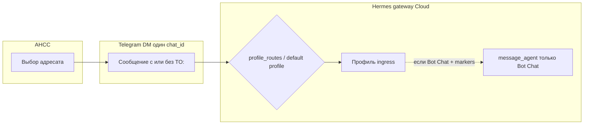

# Шаг 0: связь между Hermes-профилями и изоляция (CloudHermesAgent)

**Дата:** 2026-09-30  
**Контекст:** мультиагентный тест (MainAgent, EnglishTutor, BioStack, TaskScheduler) + AHCC с префиксом `TO:` ([AHCC-Agent-Link-Protocol.md](./AHCC-Agent-Link-Protocol.md), [AHCC-Addressees.md](../Guides/AHCC-Addressees.md)).

**Статус Cloud-инстанса:** из этого репозитория **нет** доступа к SSH/CLI CloudHermesAgent — фактическая конфигурация gateway (`multiplex_profiles`, `profile_routes`, Bot Mode markers) **не проверена на живом инстансе**. Ниже — поведение по документации Hermes Agent + текущий протокол AHCC.

---

## 1. Как один профиль отправляет сообщение другому

### 1.1. `message_agent` (Bot Mode)

| Аспект | Факт |
|--------|------|
| API | Инструмент агента: `message_agent(target="<profile_or_bot_name>", message="…")` |
| Где доступен | Только в **канонической сессии «Bot Chat»** (заголовок сессии ровно `Bot Chat`) на install, помеченном Bot Mode |
| Условия headless (gateway + Telegram) | По умолчанию **нет**: нужны вручную `hermes -p <bot> chat -c "Bot Chat" --create-if-missing` и маркер `ui_meta.hermes-bots: {}` в `profile.yaml` хотя бы одного профиля |
| Семантика | Fire-and-forget: отправитель получает ack; ответ приходит позже как фоновое уведомление в Bot Chat отправителя |
| Обычный Telegram-чат пользователя (AHCC) | **Не** Bot Chat → `message_agent` в этот ingress **не** инжектируется |

Источник: [Bot Mode](https://hermes-agent.nousresearch.com/docs/user-guide/bot-mode) (разделы «Direct messages», «What actually makes a chat a Bot Chat»).

**Вывод:** MainAgent в SOUL.md «переслать через message_agent» работает только если на Cloud включён Bot Mode headless **и** turn MainAgent идёт из Bot Chat (или отдельный orchestrator), а не из типичного DM пользователя AHCC.

### 1.2. `gateway.profile_routes` + `multiplex_profiles`

| Аспект | Фact |
|--------|------|
| Назначение | Выбор **профиля по метаданным платформы** (Telegram `chat_id`, `thread_id`; Discord `guild_id` / channel / thread и т.д.) |
| Требование | `gateway.multiplex_profiles: true` |
| Тело сообщения | **`TO:` в тексте не разбирается** — маршрутизация не по первой строке |
| AHCC | Один личный чат с ботом → один `chat_id` → без отдельных топиков/чатов все сообщения попадают в **default / unmatched route** профиль |

Источник: [Multi-profile gateways](https://hermes-agent.nousresearch.com/docs/user-guide/multi-profile-gateways), [profile-routing.md](https://github.com/NousResearch/hermes-agent/blob/main/docs/profile-routing.md).

**Вариант для AHCC без смены клиента:** Telegram forum/supergroup с топиком на профиль + `profile_routes` по `thread_id` (клиент должен писать в нужный топик, а не только добавлять `TO:` в DM).

### 1.3. Отдельные gateway / bot token на профиль

Каждый профиль может иметь свой `TELEGRAM_BOT_TOKEN` и свой процесс gateway. Два профиля с одним токеном блокируются.

AHCC сегодня: **одна** пользовательская Telegram-сессия в **один** чат с Hermes → **один** ingress. Мультиботовая схема «4 бота на телефоне» в AHCC не реализована.

### 1.4. Kanban / delegate_task

- **Kanban:** оркестратор направляет задачи на worker-профили по описанию профиля (`hermes profile describe`), не по `TO:` в сообщении клиента.
- **`delegate_task`:** subagents **внутри одного** профиля/сессии, не замена cross-profile Hermes state.

### 1.5. Протокол AHCC `TO: <addressing_key>`

Реализован **только на клиенте** (`Addressee.wireText()`): при выборе адресата ≠ MainAgent первая строка исходящего текста — `TO: <id>`.

В upstream Hermes **нет** документированного парсера строки `TO:` на gateway. Планируемый родственный механизм — **slash-command profile routing** (`gateway.profile_command_routing`, issue #52860), не префикс `TO:`.

### 1.6. Сводка: что реально для CloudHermesAgent + AHCC

| Путь | Кто маршрутизирует | Прямой inter-profile API в DM? |
|------|-------------------|--------------------------------|
| **A. Клиент-адресат ≠ MainAgent** | Клиент добавляет `TO:`; сервер должен понять ключ | **Нет** нативного API по `TO:` — нужен router на default-профиле (SOUL + `message_agent` или кастом на Cloud) |
| **B. MainAgent получает всё без `TO:`** | MainAgent отвечает сам | N/A |
| **C. MainAgent должен переслать по `TO:` в теле** | Модель + `message_agent` | Только при Bot Mode headless; иначе **не работает** |
| **D. profile_routes по thread/chat** | Gateway | Да, изоляция профиля на ingress; AHCC должен попадать в разные thread/chat |
| **E. Пользователь дважды дергает клиент** | Клиент меняет адресата и шлёт второе сообщение | **Да как паттерн «клиент-посредник»** без MainAgent как relay |

**Рекомендация до проверки Cloud:**

1. **Не строить MainAgent SOUL на «я сам перешлю через message_agent»**, пока на инстансе не подтверждены Bot Mode markers и канонические Bot Chat для всех четырёх профилей **или** не найден Cloud-specific router по `TO:`.
2. **Основной рабочий паттерн для AHCC (уже в коде):** пользователь выбирает адресата → клиент шлёт `TO: <profile_id>\n…` в тот же Telegram-чат → на сервере **обязан** быть слой, который по первой строке выбирает профиль Hermes (кастом gateway hook / attendant profile / проверить, есть ли это в Nous Portal Cloud out-of-the-box).
3. Если такого слоя на Cloud **нет** — единственный гарантированный вариант без доработки сервера: **не один DM**, а **profile_routes** (топики/чаты) или **отдельные боты** + доработка AHCC.

**Действие на Шаге 1 (после вашего OK):** на CloudHermesAgent проверить `config.yaml` default-профиля: `gateway.multiplex_profiles`, `profile_routes`, наличие middleware/skills для `TO:`, Bot Mode в `profile.yaml`.

---

## 2. Что «shared by default» между профилями

Фраза «Profiles do not sandbox the agent» относится к **файловой системе ОС**, не к памяти Hermes.

### 2.1. Изолировано per profile (`HERMES_HOME`)

Под каждым `~/.hermes/profiles/<name>/` отдельно:

- `config.yaml`, `.env`, `SOUL.md`, skills (копии/свои)
- sessions, `state.db`, cron, gateway state для этого профиля
- **memory** (локальная и конфиг `memory.provider` в пределах home профиля)

Два процесса **не должны** писать в один и тот же profile home — память смешивается в prompt.

### 2.2. Общее на одной машине / install

| Ресурс | Shared? |
|--------|---------|
| Бинарь/код Hermes, `hermes update`, bundled skills sync | Да, один install |
| OAuth logins (при clone) | Shared, не копируются в clone |
| **HOME ОС** для tool subprocess (`git`, `ssh`, `gh`, npm…) | **Да по умолчанию** — профили видят один `~/.ssh`, `~/.gitconfig` |
| `terminal.home_mode: profile` | Opt-in: отдельный `{HERMES_HOME}/home` на профиль |
| Bot token | **Не** shared между профилями при clone (channels stripped); один token = один владелец gateway |
| MCP с разными credentials | Разные connections per profile |
| Kanban workers / Bot delivery children | Env и secrets **только** assignee-профиля |

**Риск для MainAgent:** не «общая память Hermes между профилями» (она раздельная), а **общий OS HOME и один Telegram ingress**, если router не выставляет правильный `HERMES_HOME` на каждый turn.

### 2.3. BioStack / TaskScheduler

В репозитории NousPortalCloudHermes **нет** прикладной роли для BioStack или TaskScheduler — только задел под мультиадресатов в AHCC. **Допущение пользователя верно:** заглушки SOUL достаточны до отдельного ТЗ.

---

## 3. Доступ к CloudHermesAgent (для Шага 1)

| Канал | Доступ из Cursor / этого репо |
|-------|----------------------------------|
| SSH / `hermes profile create` на инстансе | **Не подтверждён** — выполняет владелец инстанса или через Portal |
| Веб-дашборд PROFILES | Ожидаемый путь для Cloud, если CLI недоступен |

После Шага 0: **остановка** — нужно ваше подтверждение выбранной модели маршрутизации (п. 1.6) и сообщение, есть ли у вас CLI на Cloud или только дашборд.

---

## 4. Ссылки

- [Hermes Profiles](https://hermes-agent.nousresearch.com/docs/user-guide/profiles)
- [Multi-profile gateways / profile_routes](https://hermes-agent.nousresearch.com/docs/user-guide/multi-profile-gateways)
- [Bot Mode / message_agent](https://hermes-agent.nousresearch.com/docs/user-guide/bot-mode)
- Репо: `AndroidHermesCloudChat/.../Addressee.kt` — `wireText()`, ids `liaison` / `english_tutor` (на Шаге 4 планируется `main_agent`, biostack, task_scheduler)
